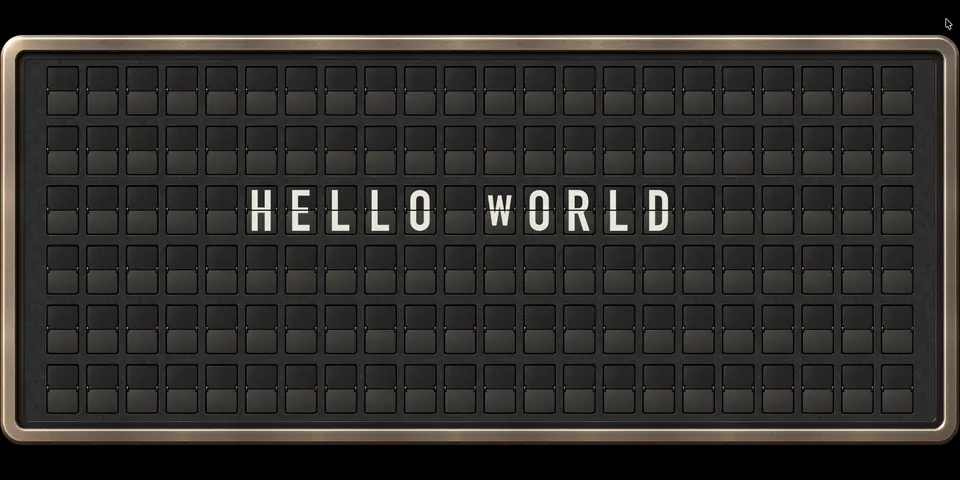

# FlapBoard for Mac

[English](#english) · [Deutsch](#deutsch)

## English

A mechanical split-flap screen saver for your clock or a few words of your own — with optional flap sounds.

The base screen saver is free to use, including for business and commercial purposes. This also applies to existing downloads of the base screen saver.

FlapBoard includes:

- A clock with optional seconds and 12- or 24-hour time.
- One custom text of up to 60 characters.
- A fixed Mechanical layout on your main display.
- Optional sound and subtle display shifting.

FlapBoard works offline. No account or companion app is needed.

**Requires macOS 14 or later. Supports Apple silicon and Intel.**

### Download and install

[Download FlapBoard for Mac](https://github.com/Shimakuchi/FlapBoard/releases/download/v1.0.0/FlapBoard-1.0.0-Mac-r3.dmg). Open it, then double-click **FlapBoard.saver** and follow the macOS installation dialog. The included **Help – English.txt** walks you through choosing FlapBoard and opening its settings. German instructions are provided separately in **Hilfe – Deutsch.txt**.

The download is signed with Developer ID and notarized by Apple. The r3 download has its own **SHA256SUMS-r3.txt** checksum file in the release assets.

### Updates

Install a newer version the same way and choose **Replace** when asked. Your saved settings are retained. Check this repository for new releases; this version does not include an automatic updater.

### Help and feedback

I develop FlapBoard independently. For help, [contact me](https://gutmann.app/en/contact/). You can also report a problem in this repository's Issues. Include your macOS version, Mac model, FlapBoard version and steps to reproduce. Do not include private messages, credentials or unreviewed diagnostic files.

### About this repository

This repository contains downloads, release notes and support information. It is not a source-code release.

---

## Deutsch

FlapBoard bringt eine mechanische Klappanzeige auf deinen Mac: als Uhr oder für ein paar eigene Worte — auf Wunsch mit Klappengeräuschen.

Der Basis-Bildschirmschoner ist kostenlos nutzbar, auch beruflich und gewerblich. Das gilt auch für bereits heruntergeladene Versionen des Basis-Bildschirmschoners.

FlapBoard bietet:

- Eine Uhr mit optionalen Sekunden und 12- oder 24-Stunden-Anzeige.
- Einen eigenen Text mit bis zu 60 Zeichen.
- Ein festes Mechanical-Layout auf deinem Hauptbildschirm.
- Optionalen Sound und eine leichte Verschiebung der Anzeige.

FlapBoard funktioniert offline. Du brauchst weder ein Konto noch eine zusätzliche App.

**Ab macOS 14, für Apple Silicon und Intel.**

### Herunterladen und installieren

[FlapBoard für Mac herunterladen](https://github.com/Shimakuchi/FlapBoard/releases/download/v1.0.0/FlapBoard-1.0.0-Mac-r3.dmg). Öffne das Disk-Image, starte **FlapBoard.saver** per Doppelklick und folge dem Installationsdialog. Die Datei **Hilfe – Deutsch.txt** erklärt Einrichtung und Einstellungen auf Deutsch. Die englische Anleitung liegt separat als **Help – English.txt** bei.

Der Download ist mit Developer ID signiert und von Apple notarisiert. Für den r3-Download liegt im Release die eigene Prüfsummendatei **SHA256SUMS-r3.txt** bei.

### Updates

Updates installierst du auf demselben Weg mit **Ersetzen**; deine Einstellungen bleiben erhalten. Neue Versionen findest du in diesem Repository. Einen automatischen Updater gibt es in dieser Version nicht.

### Hilfe und Feedback

Ich entwickle FlapBoard als unabhängiger Entwickler. Bei Fragen [kontaktiere mich](https://gutmann.app/kontakt/). Fehlerberichte sind auch über die Issues dieses Repositorys möglich. Nenne deine macOS-Version, dein Mac-Modell, die FlapBoard-Version und die Schritte zum Nachstellen. Bitte veröffentliche keine privaten Nachrichten, Zugangsdaten oder ungeprüften Diagnosedateien.

### Über dieses Repository

Dieses Repository stellt Downloads, Releasehinweise und Support bereit. Es veröffentlicht keinen Quellcode.
